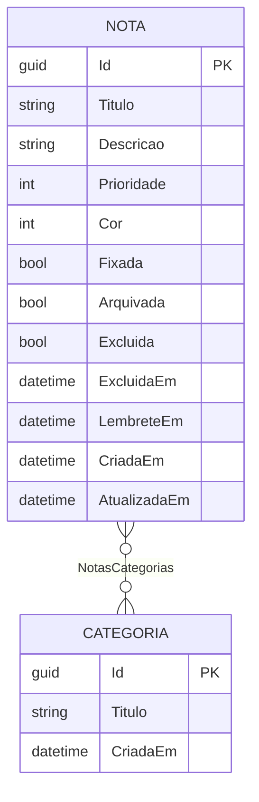

# NoteKeeper — Decisões Técnicas

> Documento central das decisões técnicas do NoteKeeper. Serve como fonte única de verdade para stack, arquitetura, modelo de domínio, persistência, convenções, testes, riscos e decisões em aberto. O escopo funcional está em [planejamento-de-produto.md](planejamento-de-produto.md).
>
> Última atualização: 24/11/2026

## 1. Contexto e objetivo

O NoteKeeper é uma aplicação web de anotações inspirada no Google Keep, de **uso individual** e **sem autenticação**. Este documento foi criado para retirar as decisões técnicas do meio do planejamento de produto e mantê-las em um único lugar.

- **Produto:** [planejamento-de-produto.md](planejamento-de-produto.md)
- **Uso:** individual, local ou em ambiente privado
- **Status:** planejamento em andamento; implementação ainda não iniciada

## 2. Resumo das decisões

| ID | Tema | Decisão | Status |
|---|---|---|---|
| DT-01 | Plataforma | .NET 10 (LTS) + ASP.NET Core MVC | Fechada |
| DT-02 | Arquitetura | Clean Architecture: Domain, Application, Infrastructure, Web + testes | Fechada |
| DT-03 | Formato da aplicação | MVC com Views Razor; sem projeto de Web API | Fechada |
| DT-04 | Banco | SQL Server (LocalDB no desenvolvimento) | Fechada |
| DT-05 | Persistência | EF Core code-first com migrations versionadas | Fechada |
| DT-06 | Autenticação | Inexistente; uso individual, sem `OwnerId` | Fechada |
| DT-07 | Prioridade | Enum `Prioridade` com 4 níveis | Fechada |
| DT-08 | Categorias | N:N com notas; filtro por uma categoria por vez | Fechada |
| DT-09 | Exclusão | Exclusão lógica de notas; excluir categoria envia as notas à lixeira | Fechada |
| DT-10 | Lembretes | Data/hora em UTC + destaque visual; sem notificação | Fechada |
| DT-11 | Validação | DataAnnotations nas ViewModels + invariantes no domínio | Fechada |
| DT-12 | Testes | MSTest em Domain e Application | Fechada |
| DT-13 | Idioma e convenções | Código e comentários em pt-BR, identificadores sem acento | Fechada |

## 3. Stack

| Uso | Tecnologia |
|---|---|
| Runtime | .NET 10 (LTS) |
| Web | ASP.NET Core MVC (Controllers + Views Razor) |
| ORM | EF Core + `Microsoft.EntityFrameworkCore.SqlServer` |
| Banco | SQL Server (LocalDB na máquina de desenvolvimento) |
| Testes | MSTest nos projetos de Domain e Application |
| Validação | DataAnnotations nas ViewModels |
| UI | Bootstrap do template MVC ou CSS próprio |
| Versionamento do banco | Migrations do EF Core |

As versões exatas dos pacotes serão fixadas quando a implementação começar.

## 4. Arquitetura

Clean Architecture com dependências apontando para dentro:

```
src/
  NoteKeeper.Domain/          Entidades (Nota, Categoria), enums e invariantes. Sem dependências externas.
  NoteKeeper.Application/     Casos de uso, DTOs, interfaces (IRepositorioNota...) e serviços.
  NoteKeeper.Infrastructure/  EF Core, ContextoNoteKeeper, configurações, migrations e repositórios.
  NoteKeeper.Web/             ASP.NET Core MVC: Controllers, ViewModels, Views e injeção de dependência.
tests/
  NoteKeeper.Domain.Tests/
  NoteKeeper.Application.Tests/
```

```
Web ──> Application ──> Domain
 │            ▲
 └──> Infrastructure ──┘   (apenas composição/DI)
```

- **Domain**: entidades com construtores/fábricas que garantem as regras de domínio; sem atributos de banco.
- **Application**: serviços de caso de uso (`ServicoNota`, `ServicoCategoria`), DTOs, interfaces de repositório (`IRepositorioNota`, `IRepositorioCategoria`, `IUnidadeDeTrabalho`) e filtros (`FiltroNota`, `ModoListagem`).
- **Infrastructure**: `ContextoNoteKeeper`, `IEntityTypeConfiguration<>` por entidade (`ConfiguracaoNota`, `ConfiguracaoCategoria`), índices, migrations, repositórios e composição em `AdicionarInfraestrutura`. `CriadaEm`/`AtualizadaEm` centralizadas em `SaveChangesAsync`.
- **Web**: controllers finos (`NotasController`, `CategoriasController`), ViewModels com DataAnnotations, Views Razor e filtros por query string (`?categoriaId=&q=&modo=arquivadas|lixeira`).

**Sem projeto de Web API:** controllers, Views Razor e a orquestração das telas vivem no mesmo `NoteKeeper.Web`, que consome a camada Application diretamente — sem endpoints REST intermediários. Se um cliente externo for necessário no futuro, a Application já fica isolada o suficiente para receber um projeto de API sem reescrever as regras de negócio.

**Sem autenticação:** por ser de uso individual, não haverá Identity, cookies de autenticação, cadastro nem noção de dono (`OwnerId`). Todas as consultas operam sobre a mesma base local.

## 5. Modelo de domínio

### Entidades

**Nota**

| Campo | Tipo | Regras |
|---|---|---|
| `Id` | `Guid` | PK |
| `Titulo` | `string` | Obrigatório, 1..120 caracteres |
| `Descricao` | `string?` | Opcional, até 4.000 caracteres |
| `Prioridade` | `Prioridade` (enum) | Obrigatória, padrão `Media` |
| `Cor` | `CorNota` (enum) | Obrigatória, padrão `Padrao` |
| `Fixada` | `bool` | Padrão `false` |
| `Arquivada` | `bool` | Padrão `false` |
| `Excluida` | `bool` | Padrão `false` — controla a lixeira |
| `ExcluidaEm` | `DateTime?` | Preenchida ao ir para a lixeira |
| `LembreteEm` | `DateTime?` | Opcional; armazenar em UTC |
| `CriadaEm` | `DateTime` | UTC, definida na criação |
| `AtualizadaEm` | `DateTime?` | UTC, atualizada a cada alteração |
| `Categorias` | `ICollection<Categoria>` | 0..N |

**Categoria**

| Campo | Tipo | Regras |
|---|---|---|
| `Id` | `Guid` | PK |
| `Titulo` | `string` | Obrigatório, 1..60 caracteres, único (case-insensitive) |
| `CriadaEm` | `DateTime` | UTC |
| `Notas` | `ICollection<Nota>` | N:N |

### Enums

```csharp
// Identificadores sem acentos; os rótulos exibidos na interface usam acentuação.
public enum Prioridade
{
    Baixa = 1,
    Media = 2,
    Alta = 3,
    Urgente = 4
}

public enum CorNota
{
    Padrao = 0,
    Vermelho = 1,
    Laranja = 2,
    Amarelo = 3,
    Verde = 4,
    VerdeAgua = 5,
    Azul = 6,
    Roxo = 7,
    Rosa = 8,
    Cinza = 9
}
```

### Relacionamento



EF Core: relacionamento N:N com tabela de junção implícita `NotasCategorias` (`NotaId`, `CategoriaId`), chave composta e `DeleteBehavior.Cascade` apenas na junção.

### Regras de negócio

As regras **RN-01 a RN-12** descrevem o comportamento esperado do produto e estão no [planejamento de produto](planejamento-de-produto.md), seção 4. O modelo acima deve refleti-las.

## 6. Persistência

- `ContextoNoteKeeper` herda de `DbContext` e aplica as configurações por assembly.
- Tabelas: `Notas`, `Categorias` e `NotasCategorias`.
- Índices previstos: `(Excluida, Arquivada)` e `LembreteEm` em `Notas`; `Titulo` único em `Categorias`.
- **Exclusão lógica:** filtro global `Excluida == false` nas consultas de `Nota`; a lixeira usa `IgnoreQueryFilters()` explicitamente.
- **Timestamps:** `CriadaEm` e `AtualizadaEm` são preenchidas em UTC no `SaveChangesAsync`, não nas telas.
- **Exclusão de categoria:** a camada Application marca as notas da categoria com `Excluida = true` e `ExcluidaEm = agora` e remove a categoria. A cascata do banco fica restrita à tabela de junção.
- **Enums:** o diagrama representa `Prioridade` e `Cor` como inteiros; a representação definitiva (inteiro ou texto) está em DTA-01.
- **Connection string:** fora do controle de versão, via `appsettings.Development.json` ou user secrets. O código não deve conter credenciais.
- **Migrations:** geradas no projeto Infrastructure e versionadas no repositório.

## 7. Convenções de código

- Código, nomes de domínio, comentários técnicos e mensagens de exceção em português do Brasil.
- Identificadores **sem acentos** (`Titulo`, `Descricao`, `Media`, `Excluida`); acentuação apenas em textos de interface e mensagens.
- PascalCase para tipos, propriedades, métodos e constantes; camelCase para parâmetros e variáveis locais; `_camelCase` para campos privados (já refletido no `.editorconfig`).
- Prefixo `I` em interfaces e sufixo `Async` em métodos assíncronos.
- Nomes de tipos do framework permanecem em inglês (`DbContext`, `DbSet`, `Controller`, `IEntityTypeConfiguration`, `SaveChangesAsync`), pois são contratos de biblioteca.
- Nomes de projetos e a marca NoteKeeper permanecem como estão.
- Rotas e actions em português (`/notas`, `/categorias`), acompanhando o restante do código.
- Valores de enum sem acento; os rótulos exibidos na UI são acentuados.

## 8. Rotas previstas

| Rota | Descrição |
|---|---|
| `GET /notas` | Listagem com filtros (`categoriaId`, `q`, `modo`) |
| `GET/POST /notas/criar` | Criação |
| `GET/POST /notas/{id}/editar` | Edição |
| `POST /notas/{id}/fixar` | Alterna fixação |
| `POST /notas/{id}/arquivar` | Alterna arquivamento |
| `POST /notas/{id}/excluir` | Envia para a lixeira |
| `POST /notas/{id}/restaurar` | Restaura da lixeira |
| `POST /notas/{id}/excluir-definitivamente` | Exclusão definitiva |
| `GET /categorias` | Listagem/gestão de categorias |

## 9. Testes e validação

- **MSTest** nos projetos `NoteKeeper.Domain.Tests` e `NoteKeeper.Application.Tests`.
- Cobertura das regras RN-01 a RN-12: criação e validação da nota, vínculo com categorias, filtros, exclusão lógica, cascata de categoria e ordenação.
- **DataAnnotations** nas ViewModels para validação de entrada; invariantes nas entidades para não depender apenas da UI.
- Unicidade de categoria validada na Application e reforçada por índice único no banco.
- Testes de integração (banco real, `WebApplicationFactory`) ficam fora do MVP; podem ser adicionados depois (DTA-07).

## 10. Segurança e operação

- Aplicação de uso individual, sem autenticação e sem `OwnerId`.
- Execução local ou em rede confiável. Se publicada na internet, os dados ficam expostos (R5).
- Datas persistidas em UTC e convertidas para o fuso local apenas na exibição.
- Nenhum segredo ou credencial no código ou no repositório.

## 11. Riscos e débitos técnicos

| # | Risco | Mitigação |
|---|---|---|
| R1 | Exclusão em cascata de categoria pode surpreender | Modal de confirmação deixando claro que as notas vão para a lixeira |
| R2 | Validação só com DataAnnotations pode duplicar/omitir regras | Manter invariantes no domínio e testar RN-01..RN-04 |
| R3 | Exclusão lógica esquecida em alguma consulta | Filtro global do EF Core para `Excluida`, com `IgnoreQueryFilters()` explícito na lixeira |
| R4 | Lembretes em UTC × fuso local | Converter para o fuso local apenas na exibição |
| R5 | Publicar o app sem autenticação expõe todas as notas | Manter execução local/rede confiável; se houver deploy público, reavaliar autenticação |
| R6 | Nomes em português divergem de exemplos e bibliotecas em inglês | Manter termos de framework em inglês e seguir a seção 7 |

## 12. Decisões técnicas em aberto

| ID | Ponto | Opções / recomendação |
|---|---|---|
| DTA-01 | Representação de `Prioridade` e `Cor` no banco | Inteiro (proposta, alinhado ao diagrama) ou texto legível |
| DTA-02 | Limites de texto | Confirmar 120 para título, 4.000 para descrição e 60 para categoria |
| DTA-03 | Paginação | Listar tudo ou paginar (ex.: 30 por página) desde o MVP |
| DTA-04 | Unicidade de categoria | Índice único + `Trim` na aplicação? Depende da collation do SQL Server |
| DTA-05 | Seed de demonstração | Criar categorias e notas de exemplo no primeiro start? |
| DTA-06 | Migrations em produção | Aplicar no start da aplicação ou em pipeline de deploy |
| DTA-07 | Testes de integração | Adiar para depois do MVP ou incluir desde o início |
| DTA-08 | Publicação | Apenas local ou rede/cloud? Se público, a autenticação volta ao escopo (R5) |
| DTA-09 | Paleta de cores | Enum fixo (proposta) ou string hexadecimal livre |

## 13. Roadmap de implementação em fases

O roadmap segue fatias verticais: cada fase termina com a aplicação executável, os testes daquela fase verdes e uma funcionalidade utilizável de ponta a ponta. A ordem foi definida pelas dependências do domínio — primeiro o que todas as telas usam, depois as funcionalidades de organização e, por fim, a consolidação.

### Visão geral

| Fase | Nome | Funcionalidades | Entregável principal | Depende de |
|---|---|---|---|---|
| 0 | Fundação | — | Solução compilando e MVC rodando | — |
| 1 | Domínio e persistência | Base | Entidades, banco e migration inicial | 0 |
| 2 | Notas e lixeira | F1, F8 | CRUD de notas com exclusão reversível | 1 |
| 3 | Categorias e vínculo N:N | F2, F3 | Categorias e notas com 0..N categorias | 2 |
| 4 | Filtro por categoria | F4 | Listagem filtrada por uma categoria | 3 |
| 5 | Busca, fixação e arquivamento | F5, F6, F7 | Notas encontráveis e organizáveis | 4 |
| 6 | Cores e lembretes | F9, F10 | Personalização visual e destaque de lembretes | 5 |
| 7 | Consolidação | Qualidade | MVP validado e documentado | 6 |
| 8 | Pós-MVP (opcional) | — | Evoluções fora do escopo atual | 7 |

### Fase 0 — Fundação do projeto

**Objetivo:** criar o esqueleto da solução, sem regras de negócio.

**Entregáveis:**
- Solução `NoteKeeper` com os projetos Domain, Application, Infrastructure e Web (MVC) + projetos de teste.
- Referências na direção da Clean Architecture e pacotes do EF Core compatíveis com .NET 10 (linha 10.0.x; a 11.x exige net11).
- `Program.cs` do MVC com `AddControllersWithViews`, injeção de dependência e `AdicionarInfraestrutura`.
- Connection string de desenvolvimento configurada fora do código.
- Página inicial padrão do template apenas para confirmar que o host sobe.

**Critérios de saída:**
- `dotnet build` e `dotnet test` passam.
- A aplicação inicia e responde em `/`.
- Domain não referencia nenhum outro projeto; Web referencia Application e Infrastructure.

**Atenções:**
- Ainda não há entidades, banco nem telas de negócio.
- Fixar as versões dos pacotes nesta fase para evitar conflito de target framework.

### Fase 1 — Domínio e persistência

**Objetivo:** modelar o núcleo e deixar o banco pronto para as telas.

**Entregáveis:**
- Entidades `Nota` e `Categoria`, enums `Prioridade` e `CorNota` e invariantes de domínio.
- `ContextoNoteKeeper` com `ConfiguracaoNota` e `ConfiguracaoCategoria`, tabelas, índices e relacionamento N:N.
- Filtro global de exclusão lógica e preenchimento de `CriadaEm`/`AtualizadaEm` em UTC no `SaveChangesAsync`.
- Migration inicial aplicada ao SQL Server/LocalDB.
- Testes de domínio de RN-01 a RN-03 e das validações de formato do título de categoria.

**Critérios de saída:**
- Banco criado do zero com `Notas`, `Categorias` e `NotasCategorias`.
- Testes de criação, validação e normalização de título passando.
- Nenhuma tela de negócio ainda.

**Decisões necessárias antes de gerar a migration:**
- DTA-01 (representação dos enums), DTA-02 (limites de texto) e DTA-04 (unicidade de categoria).

### Fase 2 — Notas e lixeira (F1, F8)

**Objetivo:** primeira fatia vertical utilizável — criar, editar, listar e excluir notas com recuperação.

**Entregáveis:**
- `IRepositorioNota`, `ServicoNota`, `FiltroNota` e `ModoListagem`.
- `NotasController` com Views de listagem, criação e edição.
- Exclusão lógica, tela de lixeira, restauração e exclusão definitiva.
- ViewModels com DataAnnotations e mensagens de validação em pt-BR.
- Layout base com navegação entre ativas, arquivadas (ainda vazia) e lixeira.

**Critérios de saída:**
- Consigo criar uma nota apenas com título e prioridade.
- Nota excluída some da listagem e aparece na lixeira; pode ser restaurada ou excluída definitivamente.
- RN-05 e RN-06 cobertas por testes; nenhuma exclusão definitiva fora da lixeira.

**Atenções:**
- A exclusão em cascata de categoria (RN-07) fica para a fase 3, quando as categorias existirem.
- A lixeira vem junto com o CRUD de notas para evitar perda de dados entre fases.

### Fase 3 — Categorias e vínculo N:N (F2, F3)

**Objetivo:** permitir organizar notas em categorias.

**Entregáveis:**
- `IRepositorioCategoria`, `ServicoCategoria` e `CategoriasController` com CRUD completo.
- Validação de título único (case-insensitive) e normalização com `Trim`.
- Seleção múltipla de categorias no formulário de nota.
- Exclusão de categoria com confirmação explícita e envio das notas à lixeira (RN-07).

**Critérios de saída:**
- Nota pode ser criada e editada com zero, uma ou várias categorias.
- Categoria sem notas pode ser excluída; categoria com notas exige confirmação e manda as notas para a lixeira.
- Nota restaurada depois da exclusão da categoria fica sem categoria.
- RN-03, RN-04 e RN-07 cobertas por testes.

### Fase 4 — Filtro por categoria (F4)

**Objetivo:** usar as categorias como eixo de navegação.

**Entregáveis:**
- Sidebar com a lista de categorias e a opção "Todas".
- Filtro por `categoriaId` na query string, combinado com o modo de listagem.
- Estado do filtro preservado ao criar, editar, fixar e arquivar.

**Critérios de saída:**
- Ao selecionar uma categoria, só aparecem notas ativas daquela categoria.
- Filtro não mostra notas arquivadas nem na lixeira.
- RN-08 coberta por testes.

### Fase 5 — Busca, fixação e arquivamento (F5, F6, F7)

**Objetivo:** tornar a lista encontrável e organizável no dia a dia.

**Entregáveis:**
- Busca textual por título e descrição, case-insensitive, combinada com o filtro de categoria.
- Ação de fixar/desafixar com ordenação das fixadas no topo (RN-10).
- Ação de arquivar/desarquivar e tela "Arquivadas".
- Ordenação padrão: fixadas, lembretes mais próximos/vencidos e `AtualizadaEm` decrescente.

**Critérios de saída:**
- Busca retorna notas por trecho de título ou descrição, respeitando o filtro ativo.
- Nota fixada aparece antes das demais; fixar e arquivar continuam sendo flags independentes (RN-11).
- Nota arquivada some da listagem principal e reaparece em "Arquivadas".
- RN-09, RN-10 e RN-11 cobertas por testes.

**Atenções:**
- A ordenação já considera `LembreteEm`, mesmo que a interface de lembrete só chegue na fase 6.

### Fase 6 — Cores e lembretes (F9, F10)

**Objetivo:** completar a experiência visual e temporal das notas.

**Entregáveis:**
- Seletor de cor no formulário de nota e cor aplicada ao card.
- Campo de data/hora de lembrete e exibição do lembrete na listagem.
- Destaque visual para lembretes vencidos, com conversão de UTC para o fuso local na exibição.
- Ajuste da ordenação por lembrete.

**Critérios de saída:**
- Consigo escolher a cor ao criar/editar e vê-la na listagem.
- Consigo definir e remover lembrete; lembrete vencido é destacado.
- RN-12 coberta por testes.

**Decisões necessárias antes da UI de cores:**
- DTA-09 (enum fixo ou hexadecimal).

### Fase 7 — Consolidação e qualidade

**Objetivo:** fechar o MVP sem adicionar funcionalidades novas.

**Entregáveis:**
- Cobertura de testes de RN-01 a RN-12 nas camadas Domain e Application.
- Revisão de estados vazios, confirmações, mensagens de erro e comportamento responsivo.
- Verificação dos índices e das consultas principais.
- Seed de demonstração, se DTA-05 for aprovado; paginação, se DTA-03 for aprovada.
- Roteiro de teste manual e atualização dos dois documentos.

**Critérios de saída:**
- Todos os critérios de aceite do planejamento passam.
- `dotnet test` verde e nenhum débito bloqueante conhecido.
- Demonstração do fluxo completo: criar → categorizar → filtrar → buscar → fixar/arquivar → excluir/restaurar.

### Fase 8 — Pós-MVP (opcional)

Itens fora do escopo atual, para depois da validação do MVP:

- Testes de integração com banco real e `WebApplicationFactory` (DTA-07).
- Autenticação, caso o app seja publicado na internet (R5 e DTA-08).
- Estratégia de migrations em produção (DTA-06).
- Multiusuário, compartilhamento, anexos, notificações e editor rich text.

### Decisões x fases

| Decisão | Resolver antes de |
|---|---|
| DTA-01, DTA-02, DTA-04 | Fase 1 (schema do banco) |
| DTA-09 | Fase 6 (UI de cores) |
| DTA-03, DTA-05 | Fase 7 (consolidação) |
| DTA-06, DTA-07, DTA-08 | Pós-MVP / publicação |

### Regras de avanço

- Uma fase só termina quando seus critérios de saída estão atendidos e os testes estão verdes.
- Não iniciar a fase seguinte com funcionalidade pela metade da anterior.
- Se uma fase atrasar, reduzir o escopo dela — não pular os critérios de qualidade.
- Toda decisão em aberto usada por uma fase deve ser fechada antes do início dessa fase.

## 14. Histórico de revisões

| Data | Alteração |
|---|---|
| 24/11/2026 | Criação do documento, consolidando as decisões técnicas que estavam no planejamento de produto |
| 24/11/2026 | Inclusão do roadmap de implementação em fases (seção 13) |
